# Microfabrication Laboratory

This repository contains practical work, fabrication steps, laboratory photographs and device-characterization activities from the Microfabrication Laboratory.

The experiments cover glass-substrate preparation, thin-film processing, Metal–Insulator–Metal (MIM) capacitors and Organic Field-Effect Transistors (OFETs).

## Experiments

| No. | Experiment | Main activity |
|---|---|---|
| 1 | Glass sample cutting using a precision wafer cutter | Cutting and preparing glass substrates |
| 2 | Cleaning of glass substrate using a sonicator | Removing surface contaminants before fabrication |
| 3 | Fabrication of MIM capacitor | Polymer dielectric deposition and electrical characterization |
| 4 | Fabrication of OFET using P3HT and DPP-TT | Organic semiconductor device fabrication and characterization |

---

## 1. Glass Sample Cutting Using a Precision Wafer Cutter

**Aim:** To cut a glass sample into the required dimensions using a precision wafer cutter.

**Equipment:** Precision wafer cutter and glass substrate.

**Procedure:**
1. Check the cutter and release the force knob.
2. Set the reference position using the guide rails.
3. Place and align the glass sample.
4. Measure and mark the required dimensions.
5. Apply uniform pressure using the diamond cutter.
6. Make a single continuous cutting stroke.
7. Carefully separate and collect the glass pieces.

### Laboratory photographs

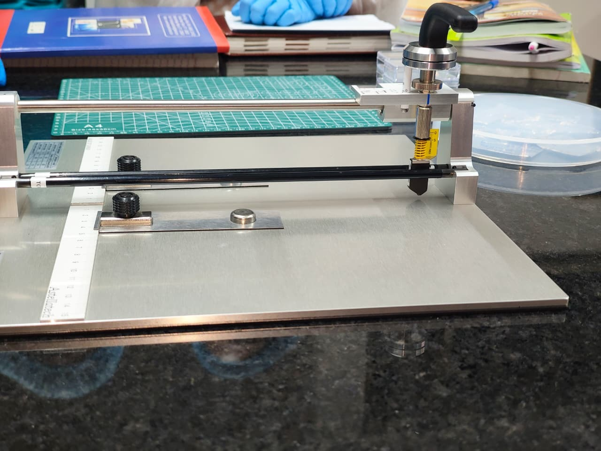

*Figure 1. Precision wafer cutter used for glass sample cutting.*

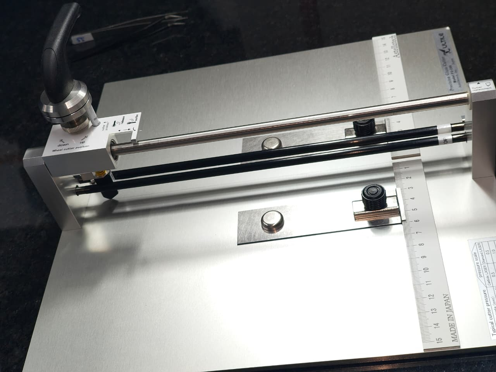

*Figure 2. Side view of the sample-cutting arrangement.*

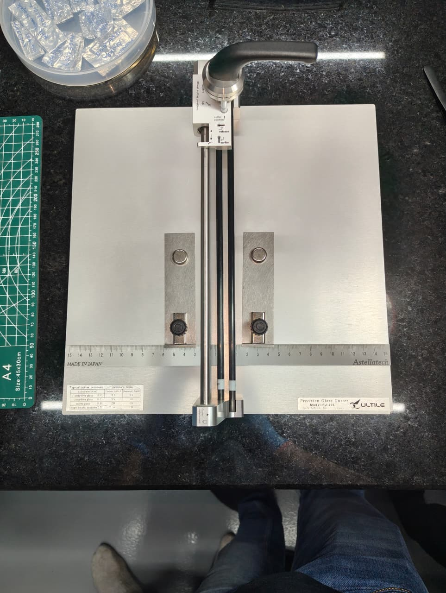

*Figure 3. Top view showing the cutter guide and sample platform.*

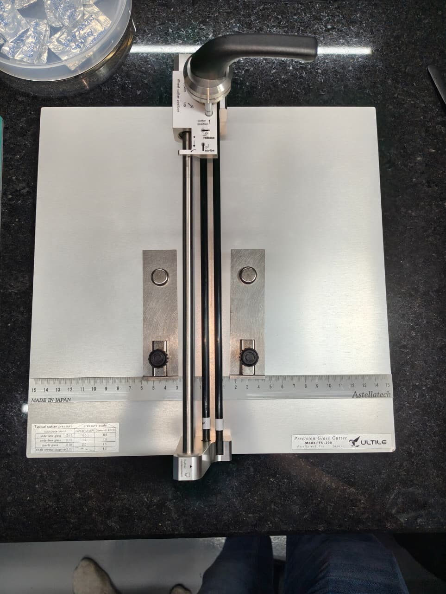

*Figure 4. Overhead view of the precision cutting setup.*

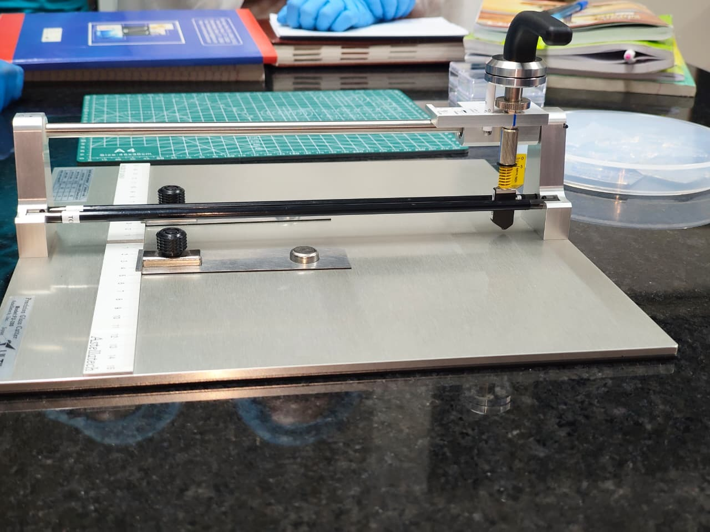

*Figure 5. Close-up view of the cutting instrument.*

---

## 2. Cleaning of Glass Substrate Using a Sonicator

**Aim:** To clean a glass substrate and remove contaminants before microfabrication.

**Materials and equipment:** Glass substrate, acetone, isopropyl alcohol (IPA), deionized (DI) water, beakers, tweezers, ultrasonic cleaner, nitrogen gun, UV-Ozone cleaner and hot plate.

**Working principle:** The ultrasonic cleaner uses high-frequency sound waves to generate cavitation bubbles in the cleaning liquid. Their formation and collapse help remove contaminants from the substrate surface. UV-Ozone treatment is used for further surface cleaning.

**Procedure:**
1. Handle the substrate using clean gloves and tweezers.
2. Sonicate it in acetone for 15 minutes.
3. Transfer it to IPA and sonicate for another 15 minutes.
4. Rinse thoroughly with DI water.
5. Dry using a nitrogen gun.
6. Perform dehydration baking.
7. Treat the substrate in the UV-Ozone cleaner.

**Outcome:** The substrate is cleaned and prepared for subsequent fabrication steps.

> The supplied photographs do not clearly show the sonicator or UV-Ozone cleaner, so no equipment photograph has been assigned to this section.

---

## 3. Fabrication of Metal–Insulator–Metal (MIM) Capacitor

**Aim:** To fabricate a MIM capacitor using polymer dielectric materials and study its electrical characteristics.

**Materials and equipment:** Glass substrate, PVDF, PVA, PMMA, polystyrene (PS), suitable solvents, metal electrode material, spin coater, hot plate, deposition system, shadow mask, LCR meter, Source Measure Unit (SMU) and stylus profiler.

**Working principle:** A MIM capacitor consists of two conducting electrodes separated by an insulating dielectric layer. Its ideal parallel-plate capacitance is

\[
C = \frac{\varepsilon A}{d}
\]

where \(\varepsilon\) is dielectric permittivity, \(A\) is the overlapping electrode area and \(d\) is dielectric thickness.

**Fabrication procedure:**
1. Clean the glass substrate using acetone, IPA and DI water.
2. Dry the substrate using nitrogen and perform dehydration baking.
3. Prepare and filter the polymer dielectric solution.
4. Deposit the dielectric layer using spin coating.
5. Dry and anneal the film to remove residual solvent.
6. Deposit the metal electrodes using a suitable deposition system and mask.
7. Measure the film thickness using a stylus profiler.
8. Characterize the capacitor using an LCR meter and SMU.

**Dielectric materials covered:** PVDF, PVA, PS and PMMA.

**Characterization:** Film thickness, capacitance, capacitance-versus-frequency and current–voltage characteristics.

### Related laboratory photographs

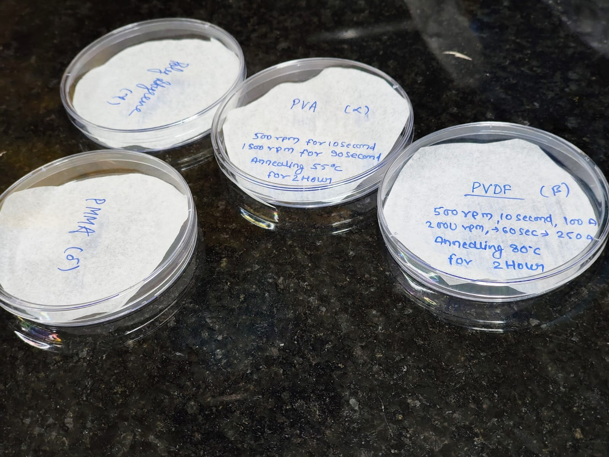

*Figure 6. Prepared samples stored in labelled containers.*

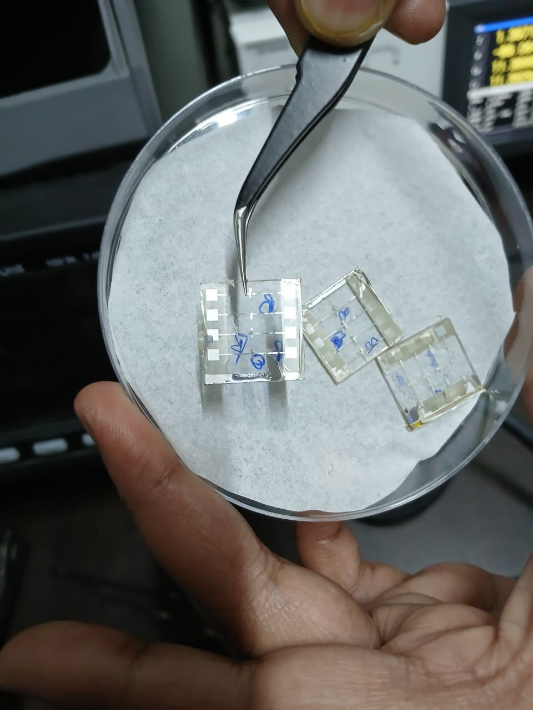

*Figure 7. Close-up photograph of a sample held for inspection.*

---

## 4. Fabrication of Organic Field-Effect Transistor (OFET) Using P3HT and DPP-TT

**Aim:** To fabricate an OFET using P3HT and DPP-TT organic semiconductors and study its electrical characteristics.

**Materials and equipment:** Glass substrate, heavily doped p-type silicon wafer with thermally grown SiO₂, P3HT, DPP-TT, gold (Au), acetone, IPA, DI water, nitrogen gun, spin coater, hot plate, thermal evaporation system, shadow mask, probe station and semiconductor parameter analyser.

**Working principle:** The organic semiconductor forms the conducting channel between the source and drain. The heavily doped p-type silicon substrate acts as the gate, while SiO₂ acts as the gate dielectric. The gate voltage controls the charge carrier concentration in the channel.

**Device layers and terminals:**
- Gate: Heavily doped p-type silicon
- Gate dielectric: SiO₂
- Organic semiconductor: P3HT or DPP-TT
- Source and drain: Gold (Au)

**Fabrication procedure:**
1. Clean the silicon substrate with SiO₂.
2. Dry the substrate using nitrogen.
3. Prepare the P3HT solution using chlorobenzene.
4. Prepare the DPP-TT solution separately.
5. Deposit the organic semiconductor layer by spin coating.
6. Allow the solvent to evaporate and form a thin film.
7. Anneal the film on a hot plate.
8. Deposit gold source and drain electrodes using thermal evaporation and a shadow mask.
9. Place the fabricated device on the probe station.
10. Connect the source, drain and gate to the semiconductor parameter analyser.

**Electrical characterization:**
- Transfer characteristics: \(I_D\) versus \(V_{GS}\), keeping \(V_{DS}\) constant.
- Output characteristics: \(I_D\) versus \(V_{DS}\) for different values of \(V_{GS}\).
- Linear and saturation regions.
- Hysteresis characteristics using forward and reverse gate-voltage sweeps.

### Laboratory photographs

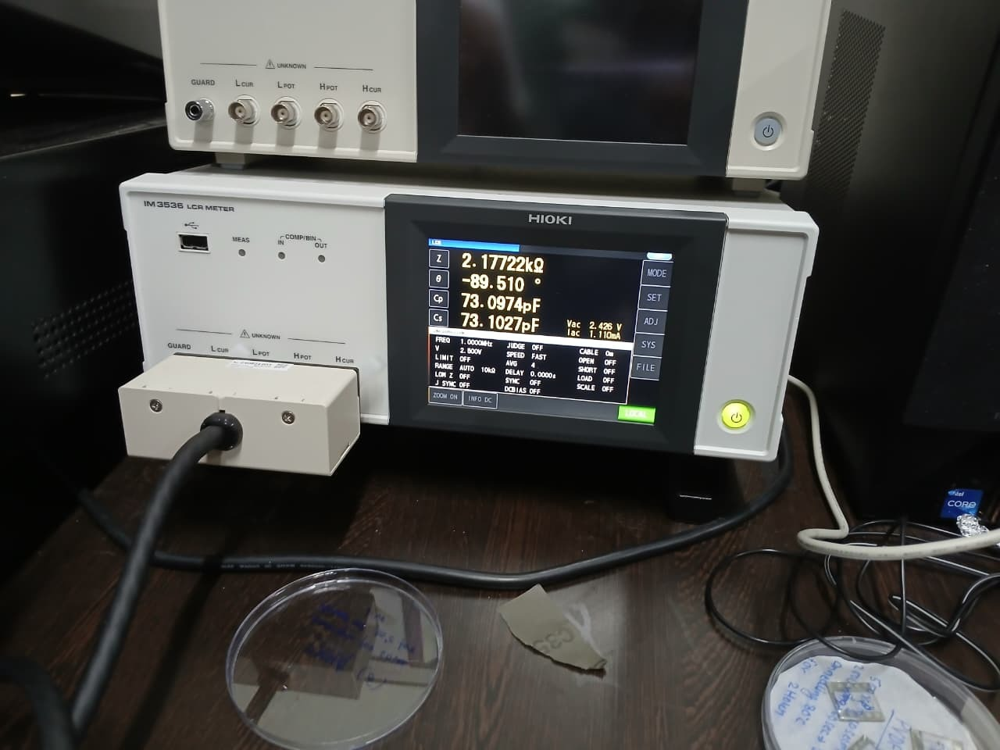

*Figure 8. Electrical measurement instrument used during laboratory work.*

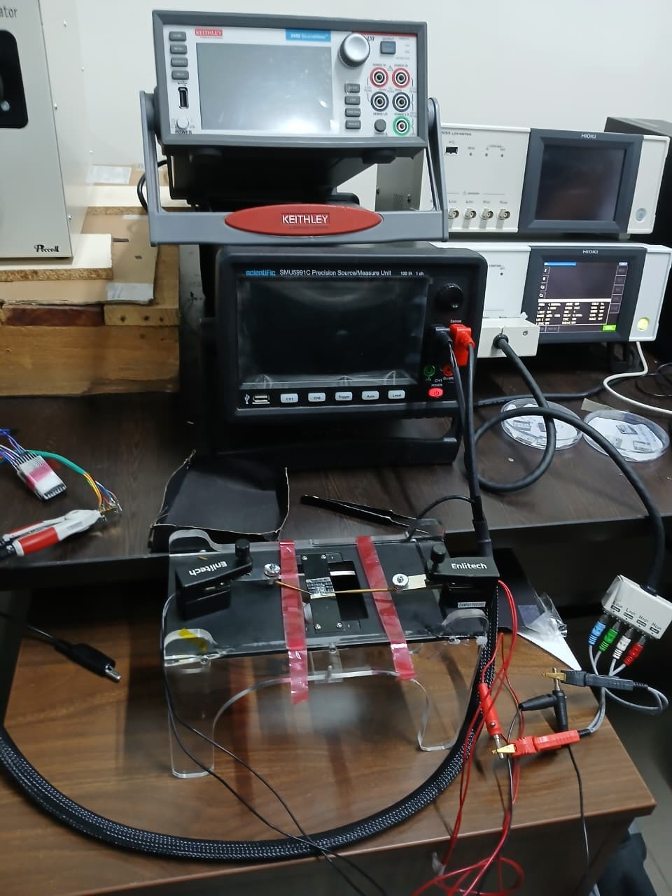

*Figure 9. Electrical measurement setup.*

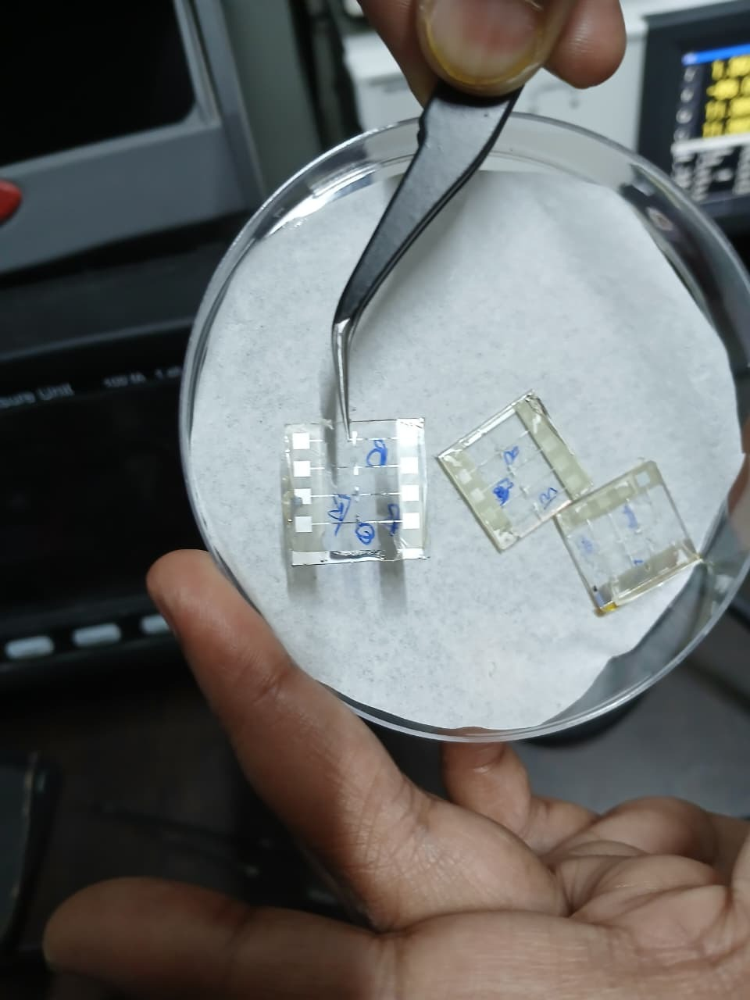

*Figure 10. Workstation used during device measurement.*

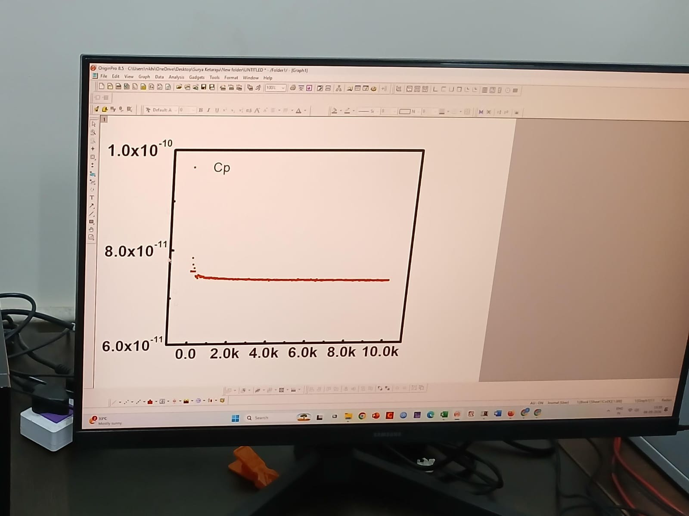

*Figure 11. Measurement graph displayed during characterization.*

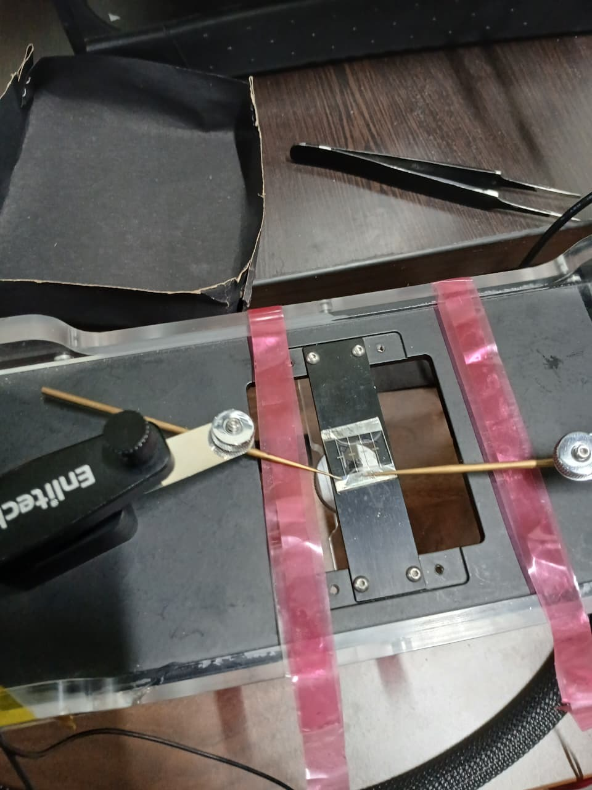

*Figure 12. Laboratory work area and sample-handling arrangement.*

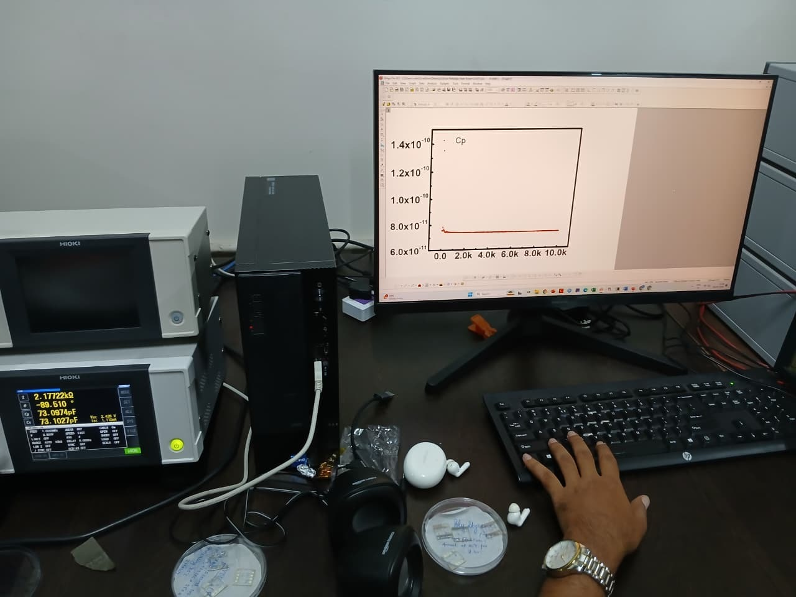

*Figure 13. Close-up view of the sample holder and device arrangement.*

---

## Laboratory Equipment Covered

- Precision wafer cutter
- Ultrasonic cleaner (sonicator)
- UV-Ozone cleaner
- Spin coater
- Thermal evaporation system
- Hot plate
- Vacuum desiccator
- Vacuum filtration and drying assembly
- LCR meter
- Semiconductor parameter analyser
- Source Measure Unit (SMU)
- Stylus profiler

## Skills and Learning Outcomes

- Glass substrate cutting and handling
- Substrate cleaning and surface preparation
- Ultrasonic cleaning and UV-Ozone treatment
- Thin-film deposition and spin coating
- Polymer dielectric preparation
- MIM capacitor fabrication and characterization
- Organic semiconductor device fabrication
- OFET structure and operation
- Film-thickness measurement
- Electrical characterization and interpretation of transfer, output and hysteresis curves

## Repository Structure

```text
Microfabrication-Lab/
├── README.md
└── images/
    ├── wafer-cutter-front.jpg
    ├── measurement-instrument.jpg
    ├── wafer-cutter-front-detail.jpg
    ├── fabricated-sample-closeup.jpg
    ├── wafer-cutter-side-view.jpg
    ├── electrical-measurement-setup.jpg
    ├── wafer-cutter-top-view.jpg
    ├── measurement-workstation.jpg
    ├── sample-holder-closeup.jpg
    ├── fabricated-samples.jpg
    ├── wafer-cutter-overhead.jpg
    ├── measurement-graph-display.jpg
    └── sample-cutting-work-area.jpg
```

**Note:** The photographs in this repository are from the supplied laboratory images. Captions identify only what is visibly supported by each photograph; equipment not clearly shown has not been assigned a photograph.
